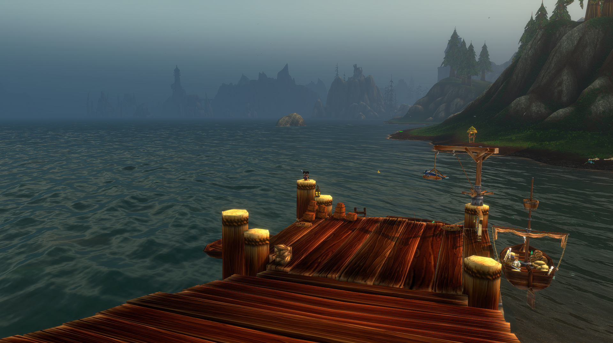
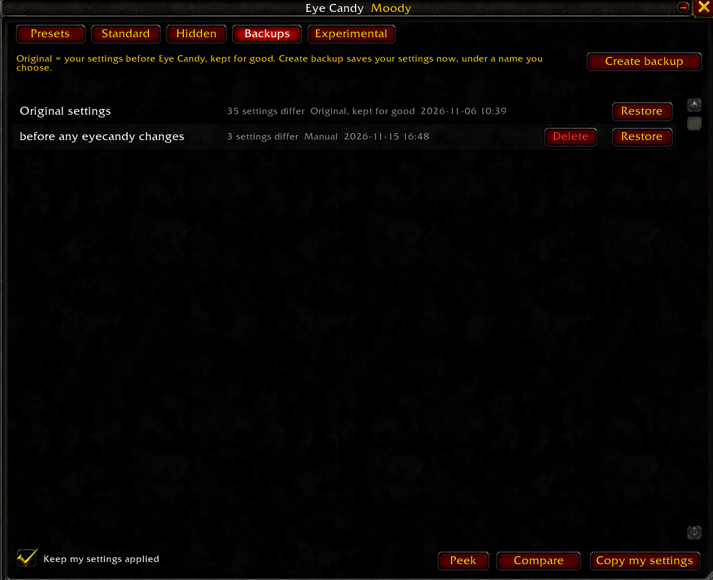
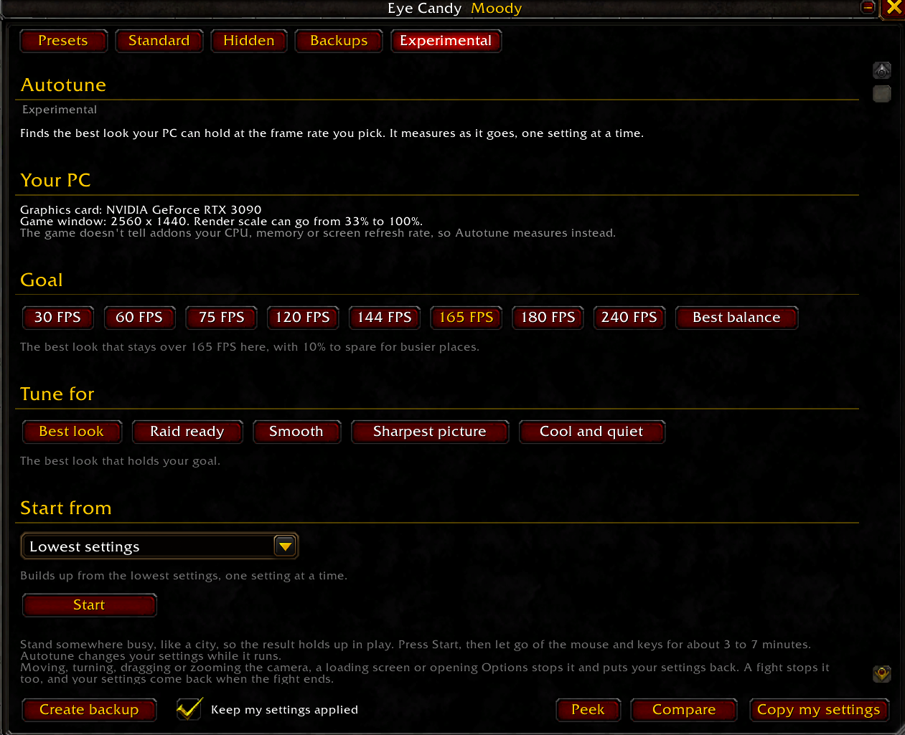

# Eye Candy

Graphics presets, curated looks, hidden graphics settings and dated backups for World of Warcraft: Forever.

Version 1.0.1. Open it with `/ec` or `/graphics`.

Get it on [Wago](https://addons.wago.io/addons/nKWw5oKE). CurseForge: waiting for its moderators to approve it.

| Before | After the Moody look |
| --- | --- |
|  |  |


## What it does

- **Presets in one click.** Six quality levels (Performance to Showcase), five Looks (Beautiful, Painterly, Crisp, Moody, Classic) and four for a job (Raid & PvP, Laptop, Screenshot, Capital city).
- **Your own presets.** Save, rename, duplicate and delete. Share one as a short code. A friend imports it and sees what it changes before it saves.
- **Hidden settings.** About 60 settings the game's menu does not show, each with a plain description. Every number setting is a slider with a typed box.
- **Standard tab.** The game's own Graphics menu in one place.
- **Dated backups.** Your Original settings (made once and kept for good) and backups you name. Eye Candy makes no other backup by itself. On the Backups tab, Restore shows what will change first.
- **Back to before.** The Presets tab lists what you did today: each preset, each restore, and your own changes between them. Each has its own Back, which puts back your settings from just before that step. It asks first and says how many settings change.
- **Peek and Compare.** Peek hides the game's UI to show the picture. Compare flips between before your last preset and now, in the same spot.
- **Steadier frames in cities.** Off until you turn it on (`/ec city`). In a capital city it lowers view distance, environment detail, fog and far-away character detail where yours are higher, and puts them back when you leave.
- **Autotune (experimental).** Pick a frame rate, and what to tune for: Best look, Raid ready, Smooth, Sharpest picture or Cool and quiet. Autotune measures as it goes, one setting at a time, and finds the best look your PC can hold at it.
- **Easy to find your way.** Search the Standard and Hidden tabs. A gold dot marks a setting you changed. Move, resize and shrink every window. Right-click the minimap button to open Backups.

## The tabs

| Standard | Hidden |
| --- | --- |
|  |  |

| Backups | Experimental |
| --- | --- |
|  |  |

## Install

Copy the `EyeCandy` folder into `World of Warcraft\_forever_\Interface\AddOns\` and start the game.

## Slash commands

`/ec` and `/graphics` do the same thing. `/ec help` lists these in game. If another addon also uses `/ec`, the game may open that one instead: `/eyecandy` always opens Eye Candy.

| Command | What it does |
| --- | --- |
| `/ec` | Open the window |
| `/ec peek` | Hide the game's UI and Eye Candy to see the picture; Back or Esc returns |
| `/ec compare` | Flip between before your last preset and now; `compare stop` ends on now |
| `/ec hidden` | Open the Hidden tab (also `advanced`) |
| `/ec preset <performance\|balanced\|high\|ultra\|cinematic>` | Set every system to one quality level and apply |
| `/ec showcase` | Cinematic plus the Showcase hidden settings |
| `/ec look <beautiful\|painterly\|crisp\|moody\|classic>` | Apply a Look |
| `/ec look <raid\|laptop\|screenshot\|city>` | Apply a preset for a job |
| `/ec back` | Go back one step: undo the newest step in today's list |
| `/ec presets` | List presets |
| `/ec save <name>` | Save your current settings as a preset |
| `/ec use <name>` | Apply a preset |
| `/ec share <name>` | Make a share code |
| `/ec backups` | List backups |
| `/ec backup [name]` | Make a backup |
| `/ec restore <number>` | Restore a backup, no question asked. It makes no backup of now (`/ec restore` alone restores the Original) |
| `/ec city` | Turn the city switch on or off (`city on`, `city off`) |
| `/ec apply` | Apply your settings again |
| `/ec minimap` | Show or hide the minimap button |
| `/ec fade` | Turn off (or on) the window fading a little when the mouse is away |
| `/ec find <word>` | Search the game's settings, with the game's own descriptions |
| `/ec export [all]` | Open a box with your settings, to copy |
| `/ec report` | Open a box with a bug report, to copy |

## Report a bug

1. In game, type `/ec report`. A box opens with your Eye Candy version, game build, settings and any recent Lua errors from Eye Candy. Press Ctrl+C to copy it.
2. Open [a new bug report](https://github.com/PortalPi/EyeCandy/issues/new/choose) and paste the text into the form.

## Build and test

The addon is plain Lua. There is nothing to build: the `EyeCandy` folder is the addon.

Tests run in Python with Lua 5.1 stubs (a stand-in for the game, in `tests/harness.lua`):

```
pip install -r tests/requirements.txt
python tests/test_presets.py
```

Each change has its own test file in `tests/test_<area>.py`. Run the one for the area you changed. They print PASS or FAIL for each check, and "ALL PASS" at the end. `tests/run.py` is the older full suite.

Nothing in the game itself can be tested this way. Try changes in game with `/reload` (a `.toc` change needs a full restart).

## Docs

- `CONTRIBUTING.md`: layout, dev loop, game facts and rules.
- `docs/cvar_audit.txt`: Blizzard's help text and defaults for each setting.
- `media/`: the logo and the screenshots for this page and the CurseForge and Wago pages. They don't ship with the addon.
- `CHANGELOG.md`: what changed, for players.

## Licence

MIT. See `LICENSE`.
