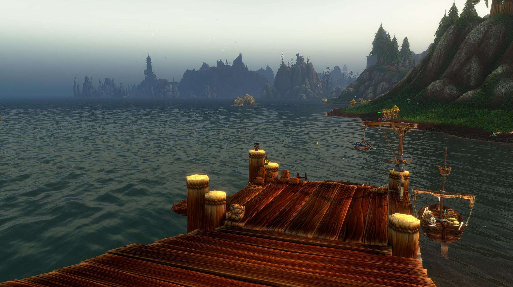
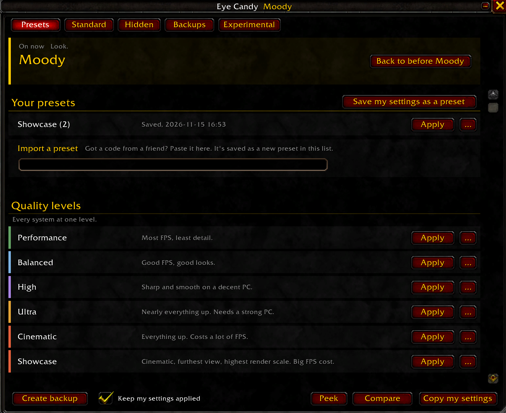
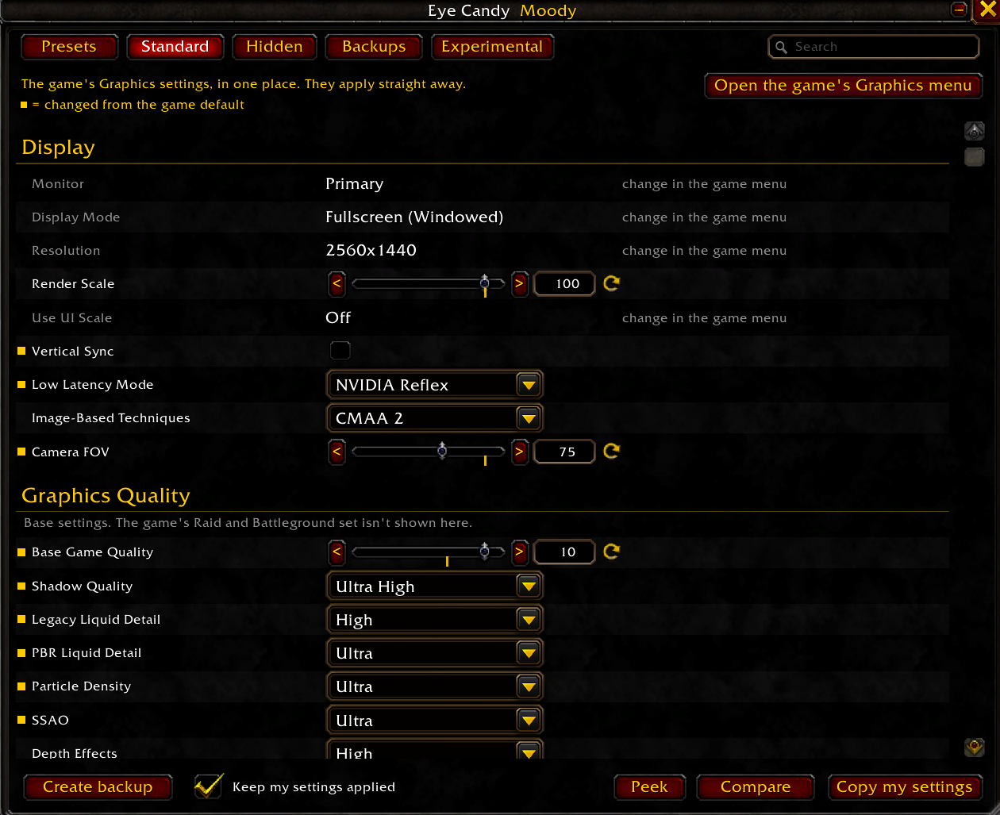
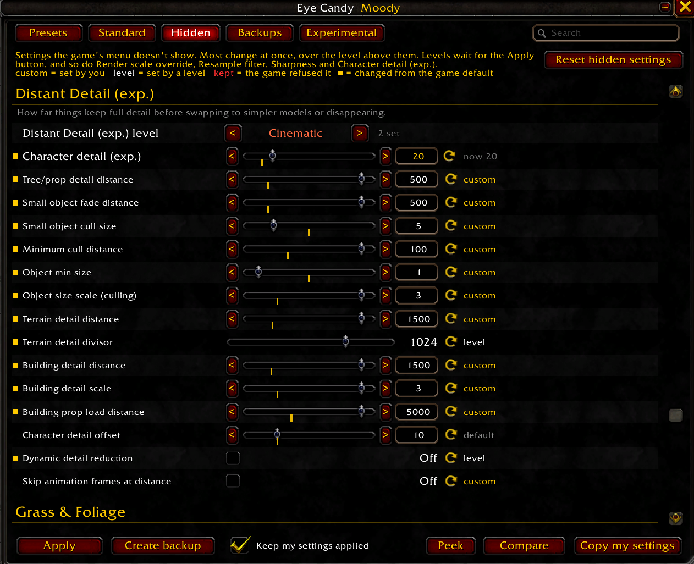

# Eye Candy

Graphics presets, Looks, hidden graphics settings and backups for World of Warcraft: Forever.

Version 1.1.0. Open it with `/ec` or `/graphics`.

Get it on [CurseForge](https://www.curseforge.com/wow/addons/eye-candy-graphics-presets-hidden-settings) or [Wago](https://addons.wago.io/addons/nKWw5oKE).

| Before | After the Moody look |
| --- | --- |
|  |  |



## What it does

- **Presets in one click.** Six quality levels (Performance to Showcase), five Looks (Beautiful, Painterly, Crisp, Moody, Classic) and four for a job (Raid & PvP, Laptop, Screenshot, Capital city).
- **Your own presets.** Save, rename, duplicate and delete. Share one as a short code. A friend imports it and sees what it changes before it saves.
- **Hidden settings.** Over 60 settings the game's menu doesn't show, each with a plain description and a slider.
- **Standard tab.** The game's own Graphics menu in one place.
- **Backups.** Your Original settings, which can't be deleted, and backups you name. Restore says how many settings change first.
- **Back to before.** The Presets tab lists what you did today. Back on any step puts your settings back to just before it, after asking.
- **Peek and Compare.** Peek hides the game's UI to show the picture. Compare flips between before your last preset and now, in the same spot.
- **Render scale to 200%.** Since the 14 November patch the game holds render scale at 100% until you restart it. Restart and it can go to 200%.
- **A warning when the game changes your settings.** If a patch changes them while you're logged out, a small window lists what changed. Put them back, or keep the changes.
- **Help me pick.** On the Presets tab. Pick Prettier or Faster and it suggests one preset and shows what it changes. Nothing changes until you press Apply.
- **Live FPS.** The bottom bar shows your FPS as you drag a slider.
- **Steadier frames in cities.** Off until you tick "Lower settings in capital cities" or type `/ec city`. In a capital city it lowers view distance, environment detail, fog and far-away character detail where yours are higher, until you leave.
- **Steadier frames in big fights.** Off until you tick "Lower settings in dungeons, raids, battlegrounds and arenas" or type `/ec instance`. In a dungeon, raid, battleground or arena it lowers your settings to the Raid & PvP preset's where yours are higher, until you leave.
- **Autotune (experimental).** Pick a frame rate and what matters most. Autotune finds the best look your PC can hold at it.
- **Eye test (experimental).** Like at the optician: which is better, 1 or 2? Your answers make a preset of your own.
- **Photo mode (experimental).** One button hides the UI and takes a photo, with your settings as they are or with a screenshot preset.
- **Steady FPS (experimental).** Pick an FPS goal. When FPS stays under it, render scale comes down a little, and goes back up when FPS recovers. Off until you turn it on.
- **Find your way.** Search the Standard and Hidden tabs. A gold dot marks a setting you changed. Move, resize and shrink every window.

## The tabs

| Standard | Hidden |
| --- | --- |
|  |  |

| Backups | Experimental |
| --- | --- |
|  |  |

## Install

Copy the `EyeCandy` folder into `World of Warcraft\_forever_\Interface\AddOns\` and start the game.

## Slash commands

`/ec` and `/graphics` do the same thing. `/ec help` lists these in game. If another addon also uses `/ec`, the game may open that one instead: `/eyecandy` always opens Eye Candy.

| Command | What it does |
| --- | --- |
| `/ec` | Open the window |
| `/ec peek` | Hide all UI to see the picture; Back or Esc returns |
| `/ec compare` | Flip between before your last preset and now; `compare stop` ends on now |
| `/ec hidden` | Open the Hidden tab (or `/ec advanced`) |
| `/ec preset <performance\|balanced\|high\|ultra\|cinematic>` | Set every system to one quality level and apply |
| `/ec showcase` | Cinematic, plus Showcase's hidden settings |
| `/ec look <beautiful\|painterly\|crisp\|moody\|classic>` | Apply a Look |
| `/ec look <raid\|laptop\|screenshot\|city>` | Apply a preset for a job |
| `/ec back` | Undo the newest step in today's list |
| `/ec presets` | List presets |
| `/ec save <name>` | Save your current settings as a preset |
| `/ec use <name>` | Apply a preset |
| `/ec share <name>` | Make a share code |
| `/ec backups` | List backups |
| `/ec backup [name]` | Make a backup |
| `/ec restore <number>` | Restore a backup, no question asked. It makes no backup of now (`/ec restore` alone restores the Original) |
| `/ec city` | Turn lowering in capital cities on or off (`city on`, `city off`) |
| `/ec instance` | Turn lowering in dungeons, raids, battlegrounds and arenas on or off (`instance on`, `instance off`) |
| `/ec apply` | Apply your settings again |
| `/ec minimap` | Show or hide the minimap button |
| `/ec fade` | Turn window fading on or off |
| `/ec find <word>` | Search the game's settings, with the game's own descriptions |
| `/ec export [all]` | Open a box with your settings, to copy |
| `/ec report` | Open a box with a bug report, to copy |

## Report a bug

1. In game, type `/ec report`. A box opens with your Eye Candy version, game build, settings and any recent Lua errors from Eye Candy. Press Ctrl+C to copy it.
2. Open [a new bug report](https://github.com/PortalPi/EyeCandy/issues/new/choose) and paste the text into the form. No GitHub account? Paste it in a comment on [Eye Candy's CurseForge page](https://www.curseforge.com/wow/addons/eye-candy-graphics-presets-hidden-settings/comments) instead.

## Build and test

The addon is plain Lua. There is nothing to build: the `EyeCandy` folder is the addon.

Tests run in Python with Lua 5.1 stubs (a stand-in for the game, in `tests/harness.lua`):

```
pip install -r tests/requirements.txt
python tests/test_presets.py
```

Each change has its own test file in `tests/test_<area>.py`. Run the one for the area you changed. They print PASS or FAIL for each check, and "ALL PASS" at the end. `tests/run.py` is the older full suite.

Nothing in the game itself can be tested this way. Try changes in game with `/reload` (a `.toc` change needs a full restart).

## Docs

- `CONTRIBUTING.md`: layout, dev loop, game facts and rules.
- `docs/cvar_audit.txt`: Blizzard's help text and defaults for each setting.
- `media/`: the logo and the screenshots for this page and the CurseForge and Wago pages. They don't ship with the addon.
- `CHANGELOG.md`: what changed, for players.

## Licence

MIT. See `LICENSE`.
